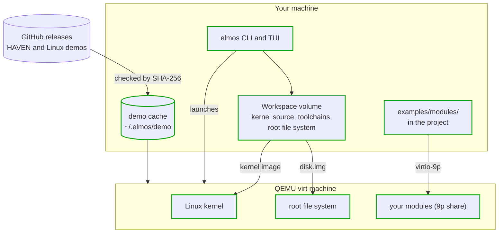

import { CardGrid, LinkCard } from "@astrojs/starlight/components";

**Embedded Linux on Multi-OS.** ELMOS builds Linux kernels, kernel modules,
user-space apps and root file systems with native cross toolchains
(crosstool-ng), and runs them in QEMU with GDB, without Docker or a VM. In
this ecosystem it also runs HAVEN and KDAL with one command
(`elmos demo haven`, `elmos demo linux`). The repository is the source of
truth: its [README](records/readme/), [guide](guide/) and
[developer pages](developer/) are copied from it on every build of this
site.

## At a glance

{/* Summary of ELMOS's docs/developer/diagrams.md, "Deployment"; keep in step. */}

More: the [architecture diagrams](developer/diagrams/) (packages, kernel
build, the HAVEN demo, types, workspace states).

## Start here

<CardGrid>
  <LinkCard title="Try it" href="records/readme/#try-it-first-no-kernel-build-no-sudo" description="Run the Linux or HAVEN demo: no kernel build, no sudo." />
  <LinkCard title="Diagrams" href="developer/diagrams/" description="Packages, workflows and the workspace, checked against the code." />
  <LinkCard title="Command reference" href="reference/cli/elmos/" description="Every command, generated from the code." />
  <LinkCard title="From the repository" href="records/readme/" description="README, guide, developer pages and changelog." />
</CardGrid>

## Where it stands

| Host | State |
| - | - |
| macOS | The full workflow |
| Linux, Windows | The CLI builds and its tests pass in CI on every change; the prebuilt Linux demo boots on all three hosts every week (on Windows without the KDAL module, which needs virtio-9p); the rest of the workflow is the project's direction |
