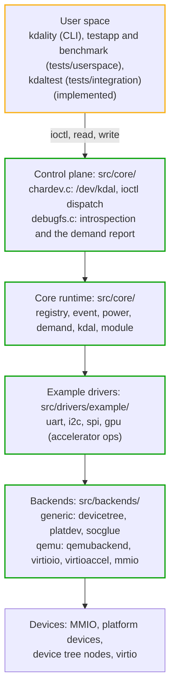

---
sidebar:
  order: 1
title: Introduction
description: What is KDAL and why does it exist?
---

:::caution[Moved from the KDAL website]
Moved from the former KDAL website (kdal/website) on 2026-11-15; not yet reviewed against the current code. KDAL's [README](../../records/readme/) and [changelog](../../records/changelog/) are copied from the repository at every build and are current.
:::

import { Aside, Card, CardGrid } from "@astrojs/starlight/components";

KDAL (**Kernel Device Abstraction Layer**) is a hardware-agnostic, pluggable
abstraction framework inside the Linux kernel that lets developers write
portable device drivers and accelerator backends **once** and run them on
**any** embedded platform.

## The Problem

Device driver development in embedded Linux is tightly coupled to specific
SoCs, kernel versions, and vendor BSPs:

- Driver code is **70%+** of the Linux kernel by lines of code
- Vendor BSPs **duplicate** driver logic for each SoC variant
- Porting a single driver across platforms costs **weeks** of engineering time
- GPU/NPU accelerator integration is even more fragmented

## The Solution

KDAL separates **what a device looks like** (registers, signals, capabilities)
from **how the driver behaves** (event handlers). It introduces a domain-specific
language (DSL) with two file types:

| File type     | Extension | Purpose                                                       |
| ------------- | --------- | ------------------------------------------------------------- |
| Device Header | `.kdh`    | Declares registers, signals, power states, capabilities       |
| Driver Code   | `.kdc`    | Implements event handlers (probe, read, write, signal, power) |

The KDAL compiler (`kdalc`) reads both files and generates a complete Linux
kernel module in C, ready to build with `make modules`.

<Aside type="tip">
    You don't need to know C to write KDAL drivers. The compiler generates all
    the kernel boilerplate automatically.
</Aside>

## Key Features

<CardGrid>
    <Card title="Compile-Time Safety" icon="approve-check">
        Register access modes (ro/wo/rw) are enforced at compile time. Writing to
        a read-only register is a compiler error, not a runtime crash.
    </Card>
    <Card title="Backend Agnostic" icon="puzzle">
        One driver works across QEMU, MMIO, platform devices, Device Tree, and
        VirtIO. Swap backends without touching driver code.
    </Card>
    <Card title="Not Turing-Complete" icon="warning">
        No recursion, no heap, no pointers, no unbounded loops. Every KDAL program
        terminates. The generated code is fully auditable.
    </Card>
    <Card title="Full Toolchain" icon="rocket">
        Compiler, CLI tool, VS Code extension, Vim plugin, standard library of
        7 device headers, and 8 CMake modules.
    </Card>
</CardGrid>

## Architecture at a Glance

The same diagram as KDAL's README (key: Start here, Reading the
diagrams): green parts are built into `kdal.ko`, which CI loads and tests with its
KUnit suites; the user-space programs build, but CI does not run them
against the module.

## Target Platforms

| Platform              | Architecture | Status           |
| --------------------- | ------------ | ---------------- |
| Linux (QEMU aarch64)  | ARM64        | Primary target   |
| Linux (native x86_64) | x86_64       | Development host |
| Linux (RISC-V)        | riscv64      | Planned          |
| macOS (Apple Silicon) | ARM64        | Toolchain only   |

## Next Steps

- [Install the SDK](../installation/) - get `kdalc` and `kdality` on your machine
- [Quick Start](../quickstart/) - write your first KDAL driver in 5 minutes
- [Language Guide](../../language/overview/) - learn the KDAL DSL in depth
