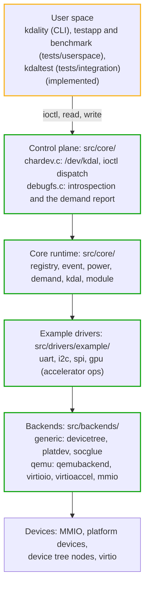

:::caution[Moved from the KDAL website]
Moved from the former KDAL website (kdal/website) on 2026-11-15; not yet reviewed against the current code. KDAL's [README](records/readme/) and [changelog](records/changelog/) are copied from the repository at every build and are current.
:::

KDAL is a hardware-agnostic abstraction framework for the Linux kernel.
Describe your device in `.kdh`, implement your driver in `.kdc`, and let the
compiler generate the kernel module. In this ecosystem, KDAL's module runs in
Linux inside HAVEN's partition A on every HAVEN pull request.

Start with the [introduction](getting-started/introduction/), then
[install](getting-started/installation/) it; the source is on
[GitHub](https://github.com/NguyenTrongPhuc552003/kdal).

import { Card, CardGrid, LinkCard } from "@astrojs/starlight/components";

## At a glance

{/* The same diagram as KDAL's README; keep in step with it. */}



The same diagram as KDAL's README (key: Start here, Reading the
diagrams): green parts are built into `kdal.ko`, which CI loads and tests with its
KUnit suites; the user-space programs build, but CI does not run them
against the module.

## Start here

<CardGrid>
  <LinkCard title="Try it" href="getting-started/quickstart/" description="Describe a device, write a driver, build the module." />
  <LinkCard title="Diagrams" href="kernel/architecture/" description="The module's layers and the compiler pipeline." />
  <LinkCard title="Language reference" href="language/spec/" description="The .kdh and .kdc languages." />
  <LinkCard title="From the repository" href="records/readme/" description="README and changelog, copied at every build." />
</CardGrid>

## Where it stands

| Part | State |
| - | - |
| Kernel module (`src/`, `include/`) and the `kdality` CLI | Active: the device-access driver inside HAVEN's Linux partition |
| Language, `kdalc` compiler, editor plugins | Frozen since 2026-11-01: kept, still built and checked by CI |


## What it offers

<CardGrid>
    <Card title="Declarative Device Headers" icon="document">
        Describe registers, signals, power states, and capabilities in `.kdh`
        files - a purpose-built DSL that catches hardware misconfigurations at
        compile time.
    </Card>
    <Card title="Imperative Driver Logic" icon="setting">
        Write event handlers in `.kdc` files with familiar control flow.
        The compiler generates correct, auditable Linux kernel C code.
    </Card>
    <Card title="Backend-Agnostic" icon="puzzle">
        One driver works across QEMU, MMIO, platform devices, Device Tree, and
        VirtIO - swap backends without touching driver code.
    </Card>
    <Card title="Full Toolchain" icon="rocket">
        `kdalc` compiler, `kdality` CLI (init, lint, simulate, compile, dt-gen,
        test-gen), VS Code extension, Vim plugin - everything you need.
    </Card>
</CardGrid>

## Quick Install

```sh
curl -fsSL https://raw.githubusercontent.com/NguyenTrongPhuc552003/kdal/main/scripts/installer/install.sh | sh
```

Or with a package manager:

```sh
# Homebrew (macOS / Linux)
brew install kdal-project/tap/kdal

# Debian / Ubuntu
sudo apt install kdal

# Fedora / RHEL
sudo dnf install kdal
```

## Target Platforms

| Platform              | Architecture | Status           |
| --------------------- | ------------ | ---------------- |
| Linux (QEMU aarch64)  | ARM64        | Primary target   |
| Linux (native x86_64) | x86_64       | Development host |
| Linux (RISC-V)        | riscv64      | Planned          |
| macOS (Apple Silicon) | ARM64        | Toolchain only   |
