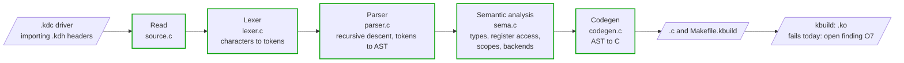

---
sidebar:
  order: 1
title: kdalc Compiler
description: The KDAL-to-C compiler - pipeline, options, and public API.
---

:::caution[Moved from the KDAL website]
Moved from the former KDAL website (kdal/website) on 2026-11-15; not yet reviewed against the current code. KDAL's [README](../../records/readme/) and [changelog](../../records/changelog/) are copied from the repository at every build and are current.
:::

`kdalc` is the core compiler that translates `.kdc` driver implementations
(together with their `.kdh` device headers) into loadable Linux kernel modules.

## Usage

```bash
kdalc [options] <file.kdc>
```

| Flag | Argument | Description                                        |
| ---- | -------- | -------------------------------------------------- |
| `-o` | `<dir>`  | Output directory (default: `.`)                    |
| `-K` | `<dir>`  | Kernel build directory (`KDIR`)                    |
| `-x` | `<pfx>`  | `CROSS_COMPILE` prefix (e.g. `aarch64-linux-gnu-`) |
| `-v` | -        | Verbose output                                     |
| `-h` | -        | Show help                                          |

### Example

```bash
# Compile a driver for the host kernel
kdalc -o build/ my_sensor_driver.kdc

# Cross-compile for aarch64
kdalc -o build/ -K /lib/modules/$(uname -r)/build \
      -x aarch64-linux-gnu- my_sensor_driver.kdc
```

The compiler produces two files in the output directory:

- **`<driver>.c`** - A self-contained kernel module source file
- **`Makefile.kbuild`** - A kbuild Makefile fragment for `make -C $KDIR M=$PWD`

## Compiler Pipeline

`kdalc` implements a four-stage pipeline with **zero external dependencies** -
no lex/yacc, no LLVM, just portable C99.



The same diagram as KDAL's `lang/DESIGN.md`: the five phases run
(`kdality compile` succeeds on every example); the generated module does
not build yet (finding O7 in KDAL's `docs/open-findings-20261121.md`).

### Stage 1 - Lexer

Hand-written tokeniser, single-pass, O(n) in source length.

- Produces a flat array of `kdal_token_t` structs
- 60+ keyword entries covering both `.kdh` and `.kdc` vocabularies
- Supports line comments (`//`) and block comments (`/* */`)
- No external tool dependency (no flex/lex)

### Stage 2 - Parser

Recursive-descent parser, LL(1) with up to 2-token lookahead.

- All nodes allocated from `kdal_arena_t` (block-based arena - no heap after parse, pointers remain stable)
- No external parser generator dependency (no bison/yacc)
- AST node hierarchy:  
  `KDAL_NODE_FILE` → device classes → registers / signals / capabilities / power / config  
  `KDAL_NODE_FILE` → drivers → handlers / statements / expressions
- Expression parser handles: literals, register paths, `read()`, binary/unary operators

### Stage 3 - Semantic Analysis

Two-scope symbol table: globals (device namespace) + locals (handler block).

| Check              | Description                                                               |
| ------------------ | ------------------------------------------------------------------------- |
| Register access    | `ro` registers reject writes; `wo` registers reject reads                 |
| Backend validation | MMIO backend requires `@` offset annotation on every register             |
| Bounded loops      | `for` upper bound must be a compile-time integer constant                 |
| IRQ safety         | Warning for `wait()` inside `on_write` handler (may block in IRQ context) |

Symbol kinds: `SYM_REGISTER`, `SYM_SIGNAL`, `SYM_CAPABILITY`, `SYM_CONFIG`, `SYM_LOCAL_VAR`.

### Stage 4 - Code Generation

Emits a standalone Linux kernel module using the `platform_device` driver model.

| Input construct      | Generated output                                                              |
| -------------------- | ----------------------------------------------------------------------------- |
| Driver context       | `struct <Name>_ctx` with `void __iomem *base` + `kdal_driver_t kdal`          |
| `probe` block        | `static int <Name>_probe(struct platform_device *pdev)`                       |
| `remove` block       | `static void <Name>_remove(struct platform_device *pdev)`                     |
| `on read`/`on write` | `kdal_driver_ops` callbacks                                                   |
| `on signal`          | `static irqreturn_t <Name>_irq_<sig>()` via `devm_request_irq`                |
| `on power`           | `static int <Name>_pm_<transition>()`                                         |
| Diagnostics          | `kdal_error()`, `kdal_warn()`, `kdal_note()` with `filename:line:col:` prefix |

## Public API

The compiler is also available as a C library (`libkdalc.a`):

```c
#include <codegen.h>

/* Full pipeline: lex → parse → sema → codegen */
int kdal_compile_file(const char *path, const char *outdir,
                      const char *kdir, const char *cross_compile);

/* Individual stages */
kdal_token_t *kdal_lex(const char *source, size_t len, int *count);
kdal_node_t  *kdal_parse(kdal_token_t *tokens, int count, kdal_arena_t *arena);
int           kdal_sema(kdal_node_t *root);
int           kdal_generate(kdal_node_t *root, const char *outdir,
                            const char *kdir, const char *cross_compile);
```

## Source Files

| File                         | Purpose                                              |
| ---------------------------- | ---------------------------------------------------- |
| `compiler/main.c`            | Standalone `kdalc` entry point                       |
| `compiler/lexer.c`           | Hand-written tokeniser                               |
| `compiler/parser.c`          | Recursive-descent parser                             |
| `compiler/sema.c`            | Semantic analysis                                    |
| `compiler/codegen.c`         | AST → kernel C + Kbuild                              |
| `compiler/include/token.h`   | Token type enum                                      |
| `compiler/include/ast.h`     | AST node definitions (tagged-union, arena-allocated) |
| `compiler/include/codegen.h` | Public API header                                    |
