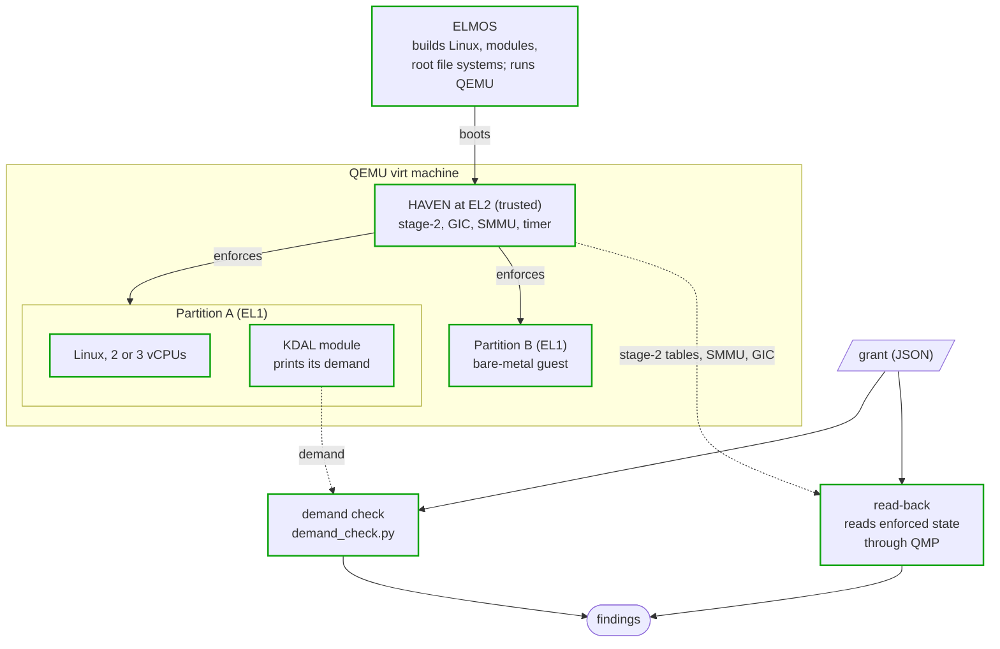

The research question behind all three: can independent read-back of the
hardware state a hypervisor enforces find enforcement drift that tests
and configuration checks miss?

| Project | Role | Uses the others? |
| - | - | - |
| **HAVEN** | Static-partitioning hypervisor at EL2 on ARM64; partitions get memory, devices, interrupts and CPU time from a *grant*; read-back compares the enforced state with the grant | no |
| **ELMOS** | macOS workbench: builds the Linux kernel, modules, apps and root file systems, runs QEMU, builds and runs HAVEN | runs HAVEN and KDAL |
| **KDAL** | Linux device abstraction module; each device reports its *demand* (MMIO, interrupts, DMA streams) | none; its demand is checked against a HAVEN grant |

Every box with a green border has run in QEMU, with recorded evidence
([how to read the diagrams](../diagrams/)).

## One vocabulary for demand and grant

A partition's grant and a driver's demand are written with the property
names of Arm's FF-A partition manifest binding: `memory-regions`,
`device-regions`, `base-address`, `pages-count`, `attributes`,
`interrupts`, `smmu-id`, `stream-ids`. So three questions can be asked of
the same data:

1. Does the grant cover what the driver needs? (KDAL's demand against the
   grant: `demand_check.py` in HAVEN.)
2. Does the hardware enforce the grant? (read-back.)
3. Does it keep enforcing it? (read-back again, later: drift.)

In QEMU the first two work today. Linux with KDAL's module boots in
HAVEN's partition A on every HAVEN pull request that changes code (2 and 3
vCPUs); the demand check and read-back run in HAVEN's evaluation campaign
(`tools/campaign/`).

## Status

These are research projects. Things marked experimental can change;
the thesis records (dated, with raw evidence) live in each repository.
